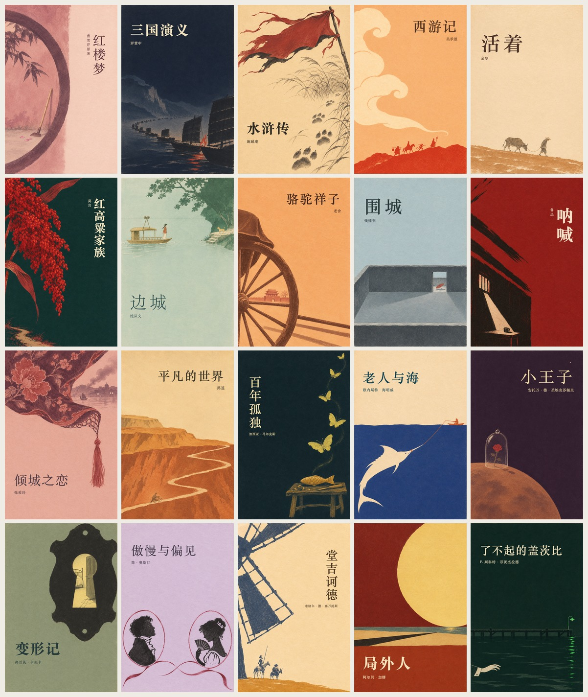

# 纸上旧书 · 经典文学二十种

从中国古典、中国现当代和外国文学中选出二十部作品，为它们创作旧书风格的平面封面。页面支持分类浏览、手机排版和大图预览。

## 在线

- Demo：https://xiaosang.cc/classic-literature-covers/
- 源码：https://github.com/holynova/classic-literature-covers

## 本地运行

在目录内运行 `python3 -m http.server 8000` 后访问 http://localhost:8000。

## 发布

站点静态文件、封面和发布回执都保存在本仓库。生产入口位于 xiaosang.cc 作品集 Worker 的 `/classic-literature-covers/` 子路径。
